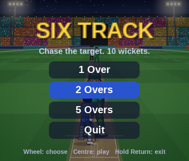
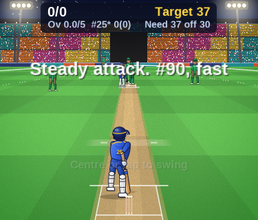
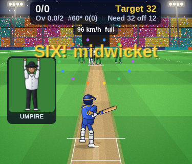
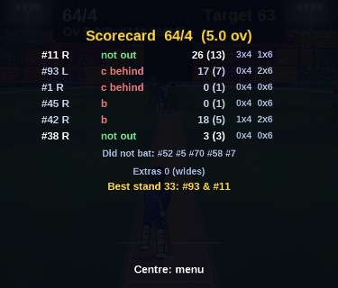

# Six Track

A one-button cricket batting game for the Shanling Q2 running [Q2 Pod](https://github.com/DiamondBond/q2-pod),
as a card game. Chase a target under the floodlights: time your swing, read the length, find the gaps.

| Menu | Batting | A six | Scorecard |
|---|---|---|---|
|  |  |  |  |

## How to play

- Pick a match: **1, 2 or 5 overs**, 10 wickets, and chase the target the game sets.
- Press **Centre** (or tap the screen) to swing. That's the only control.
- **When** you swing decides everything: the nearer the perfect moment, the better the shot (middled,
  good, mistimed, an edge, or beaten). Early sends it to the leg side, late to the off side.
- **Read the length:** a full ball is met early on the front foot, a short one late on the back foot, a
  yorker very late, spin a little earlier. A faint band on the pitch shows where for each ball.
- **Return** pauses; hold it to leave. Your music keeps playing while you bat.

## What's in it

- **Real cricket speeds:** spin 70–98 km/h, medium 110–130, fast 135–161, slower balls 95–118, with
  swing, seam and turn, every ball different.
- **A new bowler each over** (fast, medium or spin), an attack that's gentle, steady or fiery, and a
  target drawn for each match.
- **A real field:** a new field each over within the limited-overs rules (powerplay, at most two behind
  square on the leg side). Catches and stops depend on whether a fielder can get there.
- **Wides** off line or over head height, **left- and right-handed** batters, two batters rotating the
  strike, and a **scorecard** at the end.
- **The umpire's signals,** six, four, out and wide, shown close up.

Not affiliated with any cricket game, league or team. The players and artwork are original.

## Install

**Requires Q2 Pod 1.9.0 or later.**

From the Q2: **Library → App Store → Games → Six Track**. Or unzip a release's zip at the root of the
card. The game is in **Library → Games**.

## Build

Needs clang and ld.lld (no MIPS sysroot: the game makes its own system calls). The artwork needs
python3, rsvg-convert and ImageMagick.

```sh
./build.sh                          # dist/.sixtrack, the game's folder, and dist/sixtrack.zip
python3 art/pack.py                 # the players' frames into sprites.h, from art/gen_*.py
clang -DHOST sixtrack.c -o host     # a preview on a computer: frames as BMP images
```

## Credits

- The device layer (system calls, the screen, input) follows [Buddy](https://github.com/DiamondBond/q2-fidget)
  by [DiamondBond](https://github.com/DiamondBond) (MIT).
- The font is Liberation Sans Bold (SIL Open Font License 1.1), as Buddy's `font.h`.
- [Q2 Pod](https://github.com/DiamondBond/q2-pod), the firmware it runs on, by DiamondBond and the Q2 Pod
  community.

See `LICENSES.txt` for every licence.

## License

MIT. See `LICENSE`.
